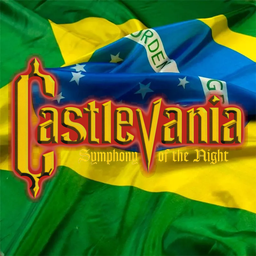

# Castlevania: Symphony of the Night — Tradução PT-BR para o SymphonyRecomp



Mod para o [SymphonyRecomp](https://github.com/BlackLabelHQ/SymphonyRecomp) que deixa o jogo em **português do Brasil**, usando a tradução clássica de **[NEODAN / PO.B.R.E., 2008](https://romhackers.org/traducoes/console/playstation/castlevania-symphony-of-the-night-po.b.r.e)**.

É só copiar e colar: o mod aplica a tradução enquanto o jogo roda.
## Requisitos

- SymphonyRecomp (testado na **v0.5.1b**)
- Sua própria imagem de **Castlevania: Symphony of the Night (USA) — SLUS-00067**, em formato **.bin/.cue**

O mod confere a versão do jogo antes de aplicar. Em outras versões ele não faz nada e mostra um aviso.

## Instalação

1. Baixe o `.zip` mais recente em **[Releases](../../releases)**.
2. Extraia a pasta `traducao-ptbr` dentro da pasta `mods` do SymphonyRecomp:
   ```
   SymphonyRecomp\
   └── mods\
       └── traducao-ptbr\
           ├── mod.json
           ├── mod-icon.png
           ├── patch\
           └── source\
   ```
3. Abra o SymphonyRecomp, vá em **Mods → Gerenciar Mods** e ative **Tradução PT-BR**.
4. Feche e abra o jogo de novo (ou use **Sistema → Hard Reset**).

Para desinstalar, desative o mod ou apague a pasta `traducao-ptbr`.

## Alternativa: instalador .bat
Prefere uma imagem do jogo já traduzida (que também roda em emuladores como o DuckStation)? 

Baixe `SOTN-Recomp-PTBR-v1.0-instalador-bat.zip`, extraia a pasta `instalador-ptbr` dentro da pasta do SymphonyRecomp e rode `APLICAR TRADUCAO.bat`. 

Ele cria uma cópia traduzida do jogo e configura o recomp para usá-la. 

**Use o mod **ou** o instalador .bat, não os dois.**


## Limitações conhecidas

Esta é a versão 1.0 BETA da tradução original (cerca de 94% traduzida). Segundo o autor:
- os nomes das áreas e os avisos "Level up", "Life max up", "Heart max up" e "Got an item" continuam em inglês;
- o prólogo, os créditos, as descrições de itens, o menu do Memory Card e a Biblioteca não têm acentos;
- no menu, "ATT" aparece como "ATA".

Detalhes no `LEIAME.txt` original, incluído na pasta do mod.

## Créditos

- **Tradução:** [Fernando Arantes Dantas (NEODAN) — PO.B.R.E., 2008](https://romhackers.org/traducoes/console/playstation/castlevania-symphony-of-the-night-po.b.r.e)
- **Mod para o SymphonyRecomp:** chawpsthiago
- **SymphonyRecomp:** [BlackLabelHQ](https://github.com/BlackLabelHQ/SymphonyRecomp)

Este repositório não contém nenhum arquivo do jogo. Você precisa ter sua própria cópia.

## Uso de IA

O código deste mod foi escrito pelo Claude Opus 5.5 e testado no jogo por mim. A tradução dos textos é inteiramente o trabalho original de NEODAN / PO.B.R.E. (2008); nenhum texto do jogo foi gerado ou alterado por IA.


---

### English

Brazilian Portuguese translation mod for [SymphonyRecomp](https://github.com/BlackLabelHQ/SymphonyRecomp), based on the 2008 fan translation by NEODAN / PO.B.R.E. The patch is applied in memory while the game reads the disc, so your disc image is never modified. Requires your own Castlevania: SOTN (USA, SLUS-00067) bin/cue image. To install, extract `traducao-ptbr` into the `mods` folder, enable it under **Mods → Manage**, then restart the game. No game files are included.

**AI disclosure:** the code of this mod was written by Claude Opus 5.5 and tested in-game by me. All in-game text is the original translation by NEODAN / PO.B.R.E. (2008); no game text was generated or altered by AI.
